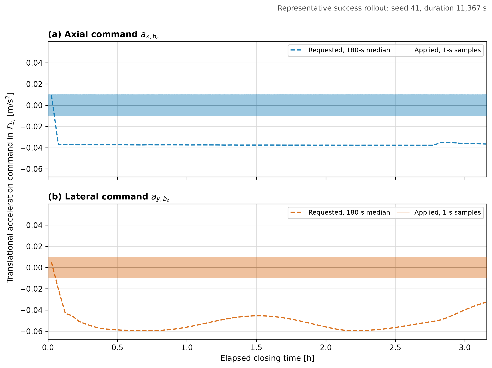
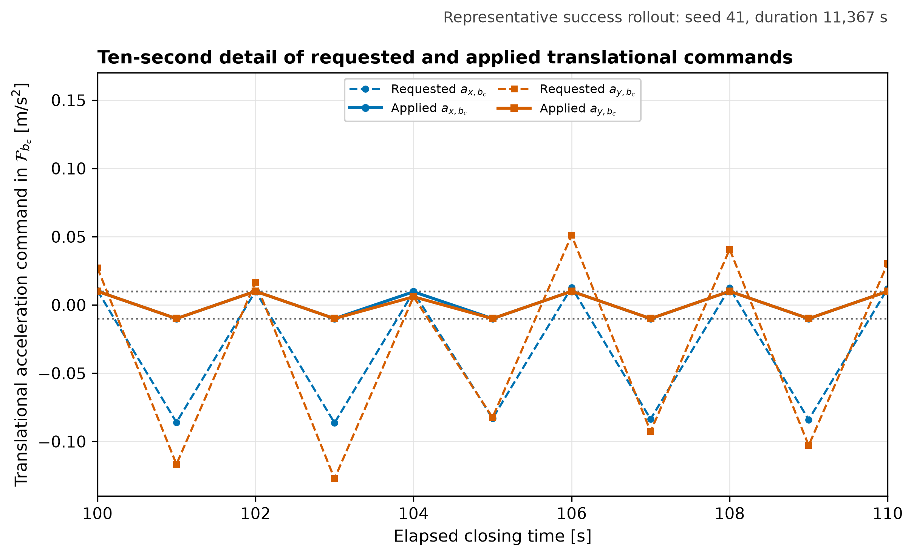
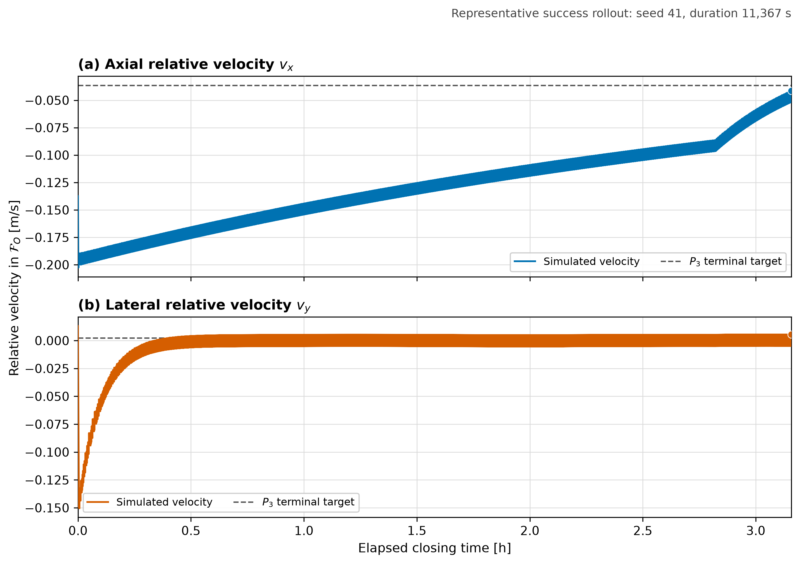

# 7.1 LQR baseline performance

## 7.1.2 Closing-phase controller

### Applied-control effort and sampled-data behavior

*Requested (raw) and applied (clipped) body-frame translational commands for
the representative successful closing rollout (seed 41). The stacked panels
show the axial component above the lateral component. Requested commands are
summarized using 180 s medians; applied commands are shown at their native 1 s
sampling interval.*

*Detail of the same command history from 100 to 110 s. The native samples
expose one-step alternation at the 1 s control interval and clipping at the
horizontal actuator limits.*

*Target-centered-orbital-frame velocity components for the same rollout. The
dashed horizontal lines denote the sampled (P_3) terminal velocities, and
the markers identify the terminal simulated values.*

The command histories show that the closing controller remains at the
translational actuator limits for most of the rollout: the requested commands
substantially exceed the available (\pm 0.01\ \mathrm{m/s^2}), so the applied
components are repeatedly clipped. The 100--110 s detail further shows
one-step sign reversal at the 1 s control interval. This command chattering is
a sampled-data limit cycle in which the demanded acceleration switches between
opposite limits; it does not mean that the chaser reverses its velocity or
position every second. Acceleration changes velocity incrementally, and the
existing approach velocity continues to carry the chaser toward (P_3). The
opposing increments largely cancel over successive pairs, but their small
imbalance, together with the body-to-orbital-frame transformation and relative
orbital dynamics, produces a nonzero slow correction that accumulates over the
11,367 s maneuver. Consistent with this interpretation, (v_x) changes from
(-0.1374) to (-0.0415\ \mathrm{m/s}), approaching its sampled (P_3) value
of (-0.0364\ \mathrm{m/s}), while (v_y) terminates at
(0.00539\ \mathrm{m/s}), near its (0.00244\ \mathrm{m/s}) target. The
rollout can therefore reach (P_3) despite the chattering, although it does so
with inefficient, nearly cancelling actuator activity and correspondingly
large accumulated control effort.

## 7.1.3 Final-approach phase controller

The selected final-approach controller completed all 50 phase-level rollouts
without timeout or hard-safety termination. This gives an observed success
rate of 100% and a 95% Wilson interval of 92.9--100%. The mean elapsed time was
3,750.0 s. At termination, the mean docking-port distance was 0.097 m and the
mean docking-port speed was 0.005 m/s. The mean attitude and angular-rate
errors were approximately \(6.87\times10^{-11}\) deg and
\(1.87\times10^{-13}\) deg/s, respectively.

At least one actuator channel was clipped during approximately 0.1% of the
executed steps. Almost all clipping was associated with a short axial-control
transient during the first 3--7 s; no clipping occurred after 7 s. The lateral
channel was clipped in only two steps across two rollouts and the angular
channel was never clipped. Thus, unlike closing, final approach was not
persistently limited by the available control authority.

**Table 7.3. Final-approach LQR evaluation after tuning.**

| Metric | Result |
|---|---:|
| Evaluation seeds | 0--49 |
| Number of rollouts | 50 |
| Successful outcomes | 50 (100%) |
| 95% Wilson interval for success | 92.9--100% |
| Timeouts | 0 (0%) |
| Observed hard-safety terminations | 0 (0%) |
| Mean elapsed time | 3,750.0 s |
| Mean any-channel clipping fraction | 0.1% |
| Mean accumulated translational effort | 0.21673 m/s |
| Mean accumulated angular effort | 0.001554 rad/s |
| Mean terminal docking-port distance | 0.097 m |
| Mean terminal docking-port speed | 0.005 m/s |
| Mean terminal attitude error | \(6.87\times10^{-11}\) deg |
| Mean terminal angular-rate error | \(1.87\times10^{-13}\) deg/s |

The final-approach translational effort had a sample standard deviation of
0.01331 m/s, a median of 0.21440 m/s, and a range of
0.19590--0.24338 m/s. The angular effort had a standard deviation of
0.000666 rad/s, a median of 0.001433 rad/s, and a range of
0.000428--0.002847 rad/s. The mean translational effort was approximately 732
times smaller than during closing, while the mean angular effort was
approximately 18 times smaller. Part of this contrast follows from the shorter
phase duration; however, the dominant difference is that final approach uses
small applied accelerations after its brief initialization transient, whereas
closing remains near the translational limits.

*Insert final-approach convergence figure here. Suggested caption:
Docking-port-relative trajectories and distance convergence for all 50
final-approach rollouts. Every trajectory terminates inside the 0.1 m docking
distance bound while satisfying the velocity, attitude, and angular-rate
requirements.*

## 7.1.4 Held-out complete-mission evaluation

After phase-level tuning, both controllers and their velocity schedules were
frozen and evaluated together over 600 held-out complete missions using seeds
300--899. The propagated terminal state of the closing phase was passed
directly to the final-approach environment; no new \(P_3\) state was sampled at
the phase transition. Final approach was attempted only when closing completed
successfully.

Of the 600 missions, 490 completed docking successfully. This corresponds to
an observed complete-mission success rate of 81.7% and a 95% Wilson interval
of 78.4--84.6%. All 110 unsuccessful missions terminated during closing:
109 reached the closing time limit and one encountered a hard velocity-safety
violation. In the latter case, seed 601, the docking-port-relative speed
reached 0.3519 m/s, marginally exceeding the 0.35 m/s hard limit. The observed
complete-mission hard-safety-termination rate was therefore 1/600, or 0.17%,
with a 95% Wilson interval of 0.03--0.94%. The lower and upper limits show that
one observed event provides only a relatively imprecise estimate of this rare
outcome.

Every mission that reached the \(P_3\) handover set subsequently docked. The
conditional final-approach rate was therefore 490/490, or 100%, with a 95%
Wilson interval of 99.2--100%. Since final approach was attempted only after
successful closing, the mission success probability can be decomposed as

\[
P(M)=P(C)P(F\mid C),
\]

where \(C\) denotes successful closing and \(F\) denotes successful final
approach. For the held-out sample,

\[
\hat P(M)=\frac{490}{600}\frac{490}{490}=\frac{490}{600}.
\]

This decomposition confirms that the final-approach transition introduced no
additional observed failure in the held-out campaign. End-to-end reliability
was governed by whether the closing controller reached the handover set.

**Table 7.4. Held-out full-mission LQR evaluation.**

| Metric | Result |
|---|---:|
| Evaluation seeds | 300--899 |
| Number of missions | 600 |
| Successful missions | 490 (81.7%) |
| 95% Wilson interval for mission success | 78.4--84.6% |
| Closing timeouts | 109 (18.2%) |
| Hard-safety terminations | 1 (0.17%) |
| 95% Wilson interval for safety termination | 0.03--0.94% |
| Phase of all unsuccessful outcomes | Closing |
| Final-approach attempts | 490 |
| Successful final-approach attempts | 490/490 (100%) |
| 95% Wilson interval for conditional final success | 99.2--100% |

*Insert representative full-mission figure here. Suggested caption: Exact
docking-port-relative position, velocity, attitude, and angular-rate histories
for a representative held-out successful mission. The vertical line denotes
the \(P_3\) controller transition and the shaded regions distinguish closing
from final approach.*

*Insert Monte Carlo convergence figure here. Suggested caption: Cumulative
held-out mission-success estimate as a function of rollout count, with 95%
Wilson limits and the 5th--95th percentile range obtained from repeated random
permutations of the 600 mission records.*

## 7.1.5 Overall interpretation

The LQR baseline demonstrates that the modeled docking task can be completed
reliably once an admissible \(P_3\) handover state is reached. The
final-approach controller succeeded for every isolated and end-to-end attempt
and required little actuator clipping or accumulated control effort. The
dominant limitation lies in closing. Although the closing controller remained
inside the hard safety set in nearly every held-out mission, it frequently
required the entire available duration and did not always satisfy the six
handover conditions simultaneously.

The closing results also demonstrate why success percentage alone is
insufficient for characterizing a baseline. The controller achieved an
approximately 82% success rate, but did so with persistent translational
clipping, a mean \(\Delta v\)-type proxy of 158.708 m/s, and one-step command
alternation in the examined representative history. These properties are
important when the LQR baseline is compared with learned or safety-filtered
controllers: a controller should be assessed not only by whether it docks,
but also by the distribution of failure modes, duration, safety events,
actuator use, and accumulated applied-control magnitude.

The reported probabilities remain conditional on the modeled dynamics,
initial-condition distributions, actuator representation, and termination
logic. In particular, the absence of spacecraft mass, thruster allocation,
minimum impulse effects, navigation error, and external disturbances means
that neither the confidence intervals nor the control-effort proxies constitute
flight qualification or a direct propellant prediction. They provide a
reproducible simulation-level reference against which the subsequent
reinforcement-learning and safety-filtered controllers can be evaluated.
