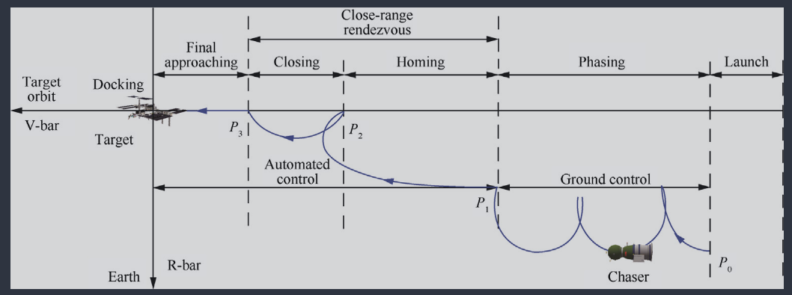
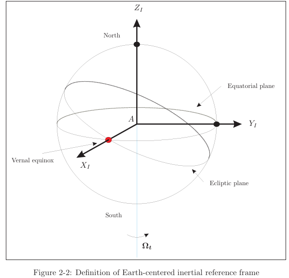
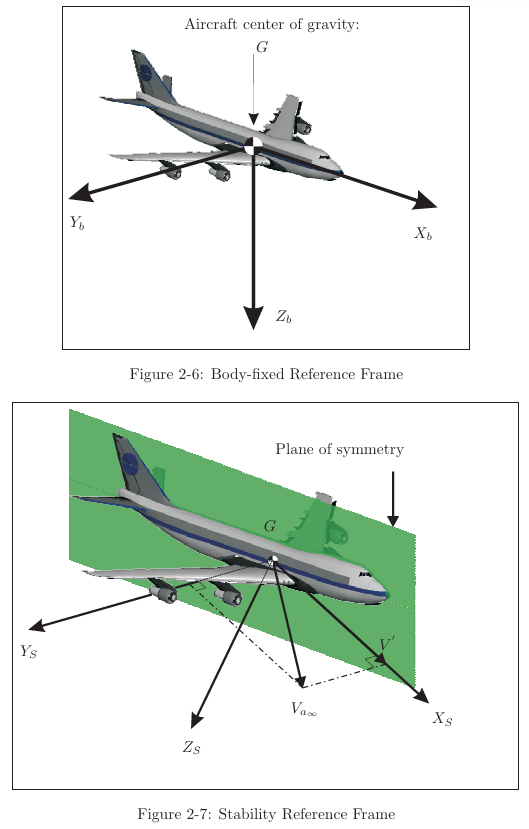
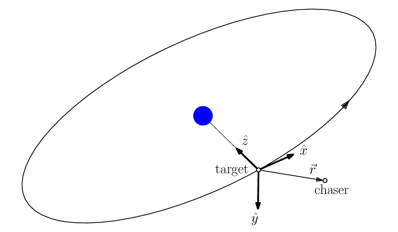
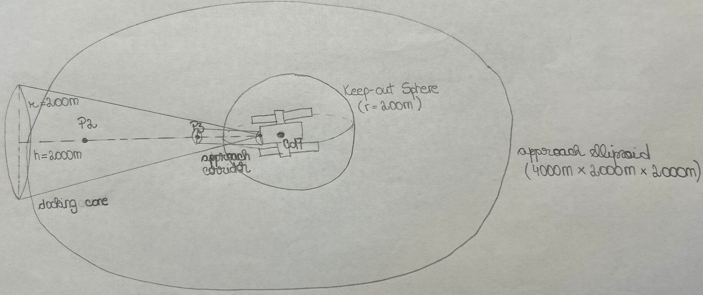

# Scenario Setup

## 1. Modeled Problem

The modeled control problem includes two sequential close-proximity rendezvous tasks, each with a dedicated autonomous controller:

1. Closing phase (P2 -> P3)
2. Final approach phase (P3 -> Docking)

 (Luo, J. Zhang, and Tang, 2014)

This split is motivated by phase-specific objectives and safety constraints:

- Closing phase prioritizes convergence from larger distance, reduction of relative velocity, and geometric preparation for final approach.
- Final approach prioritizes strict terminal precision, corridor adherence, low closing speed, and tighter safety envelopes.

### 1.1 Controller 1: Corridor Capture (P2 -> P3)

Controller 1 is responsible for transferring the chaser from close-range point P2 (couple of km away from target) to handover point P3 (hundreds of m away from target), preparing terminal docking entry conditions.

Objectives:

- Reduce range to target and stabilize near P3.
- Reduce relative velocity as range decreases.
- Place chaser in appropriate geometry for final straight-line corridor entry.

P2 to P3 is treated as a dedicated corridor-capture task so that geometry preparation and speed shaping are achieved before terminal constraints become dominant.

### 1.2 Controller 2: Terminal Docking (P3 -> Docking)

Controller 2 starts from P3 and guides the chaser through the docking corridor to admissible contact conditions.

Objectives:

- Enter and track the nominal straight-line approach corridor.
- Keep lateral error small.
- Continue reducing approach speed near contact.
- Satisfy terminal constraints on position, velocity, attitude, and angular rate.

Terminal docking is separated from corridor capture because terminal contact requires stricter and more coupled constraints than far-range convergence.

## 2. Docking Geometry and Vehicles

### 2.1 Core Geometry

- Docking axis `e_d`: centerline of target docking port, normal to docking interface plane, pointing outward.
- Target docking-port center: fixed offset from target CoM, located on front face.
- Chaser docking-port center: fixed offset from chaser CoM along chaser body x-axis, located on front face.

### 2.2 Docking-Port Relative Kinematics (Oestreich, Linares, and Gondhalekar, 2020)

Let:

- `r in R^3`: chaser CoM position relative to target CoM (target-centered frame)
- `q`: chaser attitude relative to target-centered frame
- `R(q) in R^(3x3)`: rotation from chaser body frame to target-centered frame
- `r_c in R^3`: chaser docking-port center relative to chaser CoM (chaser body frame)
- `r_t in R^3`: target docking-port center relative to target CoM (target-centered frame)

Then docking-port relative position is:

```
r_p = r + R(q) * r_c - r_t
```

Docking contact condition:

```
r_p = 0
```

If `v` is relative CoM velocity and `omega` is chaser angular velocity, docking-port relative velocity is:

```
v_p = v + omega x (R(q) * r_c)
```

Terminal conditions are imposed on `r_p`, `v_p`, attitude error, and angular velocity.

Imposing terminal constraints at docking-port level, rather than only at CoM level, better represents interface-level contact quality.

### 2.3 Vehicle Modeling (IDSS-Based)

Baseline case:

- Chaser: Boeing Starliner-like, approximated by IDSS-15T class.
- Target: ISS-like port module, approximated by IDSS-350T class.

The Starliner-like chaser is approximated with IDSS-15T because Starliner is a medium crew visiting vehicle and this class captures the IDSS medium-vehicle range (about 8 to 25 tonnes). The ISS-like target module is approximated with IDSS-350T because the baseline target represents docking to a large orbital complex and this class captures the IDSS large-complex range (about 100 to 375 tonnes).

Alternative vehicle-to-vehicle case:

- Chaser: Starliner-like, IDSS-15T.
- Target: Crew Dragon-like, IDSS-10T.

The Crew Dragon-like target is approximated with IDSS-10T because it is a medium-class crew vehicle, and using IDSS-10T with a Starliner-like IDSS-15T chaser keeps the pair in a comparable scale range while preserving an IDSS-consistent approximation.

In both cases, `r_c` and `r_t` are first-order approximations derived from IDSS reference mass-properties (Hard Capture System mating plane center coordinates relative to CoG with +x toward docking interface). Using IDSS reference mass properties avoids dependence on proprietary geometry while preserving consistent first-order port-offset modeling.

## 3. Reference Frames (AE3202 Flight Dynamics Notes)

### 3.1 Earth-Centered Inertial Frame `F_I`

Used for absolute orbital motion of target and chaser.

- Origin: Earth CoM
- `Z_I`: Earth rotation axis (toward North Pole)
- `X_I`: toward vernal equinox
- `Y_I`: completes right-handed equatorial triad



### 3.2 Target Body-Fixed Frame `F_{B_t}`

Rigidly attached to target spacecraft.

- Origin: target CoM
- `x_{B_t}`: forward toward docking interface
- `z_{B_t}`: downward in symmetry plane
- `y_{B_t}`: right-hand completion

Used for target-geometry-defined quantities such as docking-port location and docking-axis constraints.



### 3.3 Target-Centered Orbital Frame `F_O`

Used for translational relative dynamics.

- Origin: target CoM
- `x_O`: radial
- `y_O`: along-track
- `z_O`: orbit-normal

Relative position and velocity are expressed in `F_O`.



### 3.4 Chaser Body-Fixed Frame `F_{B_c}`

Rigidly attached to chaser spacecraft.

- Origin: chaser CoM
- `x_{B_c}`: forward
- `z_{B_c}`: downward in symmetry plane
- `y_{B_c}`: right-hand completion

Used for chaser-intrinsic quantities (thruster directions, inertia, body rates, control torques, docking-port offset).

The frame selection separates absolute orbital motion (`F_I`), relative translation (`F_O`), and body-tied geometry/control (`F_{B_t}`, `F_{B_c}`), which keeps the dynamics and constraints physically interpretable.

## 4. Orbit, Handover Geometry, and Initial Conditions

### 4.1 Target Orbit (ISS-like Circular LEO)

- Orbit type: circular LEO
- Altitude: 400 km
- Inclination: 51.6 deg
- Eccentricity: 0
- Semi-major axis: `a = R_E + 400 km`
- RAAN: 0 deg
- Argument of perigee: 0 deg
- True anomaly at initial time: 0 deg

Motivation: consistent with ISS-like baseline target and standard circular-reference close-proximity modeling assumptions. A circular orbit avoids additional ellipticity effects in the initial model and supports cleaner verification of relative-motion logic.

### 4.2 Reference Docking Geometry

- Docking axis aligned with positive `x_T` of target-centered frame.
- Chaser initialized on positive `x_T` side and approaches toward smaller `x_T`.
- Target attitude fixed; target angular velocity zero.

Motivation: Aligning approach with the positive docking-axis direction gives a direct interpretation of longitudinal and lateral errors, while fixed target attitude simplifies rotational coupling in early development.

### 4.3 Handover Points

- `P2`: close-range state after phasing and homing; controlled but not terminal.
- `P3`: handover/corridor-entry state; tighter than `P2`; start of terminal phase.

## 5. Nominal States and Randomized Initialization

Nominal states define reference scenarios; sampled initialization intervals define training and evaluation diversity.

Two ranges are used:

- Testing range (narrower): representative operational evaluation.
- Training range (wider): robustness-oriented learning exposure.

Motivation: Narrow test ranges evaluate representative operating performance, while wider training ranges improve robustness and reduce overfitting to one nominal state.

### 5.1 P2 Definition

#### Nominal P2 State

- Axial distance: `1700 m`
- Lateral offset: `0 m`
- Out-of-plane offset:
  - `0 m` (3-DoF)
  - `0 m` nominal (6-DoF)
- Axial relative velocity: `-0.10 m/s`
- Lateral relative velocity: `0 m/s`
- Out-of-plane relative velocity:
  - `0 m/s` (3-DoF)
  - `0 m/s` nominal (6-DoF)
- Attitude error: `0 deg` each axis
- Angular velocity: `0 deg/s` each axis

#### P2 Testing Range

- Axial distance: `1600 m` to `1800 m`
- Lateral offset: `-100 m` to `100 m`
- Out-of-plane offset:
  - `0 m` (3-DoF)
  - `-100 m` to `100 m` (6-DoF)
- Axial relative velocity: `-0.15 m/s` to `-0.05 m/s`
- Lateral relative velocity: `-0.02 m/s` to `0.02 m/s`
- Out-of-plane relative velocity:
  - `0 m/s` (3-DoF)
  - `-0.02 m/s` to `0.02 m/s` (6-DoF)
- Attitude error: `-3 deg` to `3 deg` each axis
- Angular velocity: `-0.05 deg/s` to `0.05 deg/s` each axis

#### P2 Training Range

- Axial distance: `1500 m` to `1900 m`
- Lateral offset: `-150 m` to `150 m`
- Out-of-plane offset:
  - `0 m` (3-DoF)
  - `-150 m` to `150 m` (6-DoF)
- Axial relative velocity: `-0.20 m/s` to `-0.03 m/s`
- Lateral relative velocity: `-0.03 m/s` to `0.03 m/s`
- Out-of-plane relative velocity:
  - `0 m/s` (3-DoF)
  - `-0.03 m/s` to `0.03 m/s` (6-DoF)
- Attitude error: `-5 deg` to `5 deg` each axis
- Angular velocity: `-0.10 deg/s` to `0.10 deg/s` each axis

Motivation: P2 bounds are chosen so the state remains close-range and controllable, but still diverse enough to justify a dedicated closing controller.

### 5.2 P3 Definition

#### Nominal P3 State

- Axial distance: `300 m`
- Lateral offset: `0 m`
- Out-of-plane offset:
  - `0 m` (3-DoF)
  - `0 m` nominal (6-DoF)
- Axial relative velocity: `-0.03 m/s`
- Lateral relative velocity: `0 m/s`
- Out-of-plane relative velocity:
  - `0 m/s` (3-DoF)
  - `0 m/s` nominal (6-DoF)
- Attitude error: `0 deg` each axis
- Angular velocity: `0 deg/s` each axis

#### P3 Testing Range

- Axial distance: `280 m` to `320 m`
- Lateral offset: `-3 m` to `3 m`
- Out-of-plane offset:
  - `0 m` (3-DoF)
  - `-3 m` to `3 m` (6-DoF)
- Axial relative velocity: `-0.05 m/s` to `-0.01 m/s`
- Lateral relative velocity: `-0.005 m/s` to `0.005 m/s`
- Out-of-plane relative velocity:
  - `0 m/s` (3-DoF)
  - `-0.005 m/s` to `0.005 m/s` (6-DoF)
- Attitude error: `-1 deg` to `1 deg` each axis
- Angular velocity: `-0.02 deg/s` to `0.02 deg/s` each axis

#### P3 Training Range

- Axial distance: `250 m` to `350 m`
- Lateral offset: `-5 m` to `5 m`
- Out-of-plane offset:
  - `0 m` (3-DoF)
  - `-5 m` to `5 m` (6-DoF)
- Axial relative velocity: `-0.06 m/s` to `-0.01 m/s`
- Lateral relative velocity: `-0.01 m/s` to `0.01 m/s`
- Out-of-plane relative velocity:
  - `0 m/s` (3-DoF)
  - `-0.01 m/s` to `0.01 m/s` (6-DoF)
- Attitude error: `-2 deg` to `2 deg` each axis
- Angular velocity: `-0.03 deg/s` to `0.03 deg/s` each axis

Motivation: P3 ranges are intentionally tighter than P2 to preserve clear phase separation and enforce corridor-readiness before terminal docking.

## 6. Environmental Disturbances (Starin and Eterno, 2011)

### 6.1 Baseline (Nominal) Environment

Initial model neglects environmental disturbances to validate scenario logic, dynamics implementation, handover behavior, and reward structure under controlled conditions.

Motivation: A disturbance-free baseline isolates modeling and control-design errors before introducing environment-induced variance.

### 6.2 Disturbed Environment Extension

Extended model includes main LEO disturbance torques:

- Aerodynamic drag torque
- Magnetic torque
- Gravity-gradient torque
- Solar-radiation-pressure torque

Motivation: These four effects capture the dominant first-order environmental torques for an ISS-like LEO context.

Total environmental disturbance torque:

```
tau_env = tau_aero + tau_mag + tau_gg + tau_srp
```

#### 6.2.1 Atmospheric Drag Torque

```
tau_aero = 0.5 * rho(h) * C_d * A_ram * V_rel^2 * l_aero
```

Where `rho(h)`, `C_d`, `A_ram`, `V_rel`, and `l_aero` are atmospheric density, drag coefficient, projected area, relative flow speed, and aerodynamic moment arm.

#### 6.2.2 Magnetic Torque

```
tau_mag = m_res x B_E
```

Where `m_res` is residual magnetic dipole and `B_E` is Earth magnetic field.

#### 6.2.3 Gravity-Gradient Torque

```
tau_gg = 3 * mu / r^3 * (e_r x J e_r)
```

Where `mu` is Earth gravitational parameter, `r` orbital radius, `e_r` local vertical unit vector in spacecraft frame, and `J` inertia matrix.

#### 6.2.4 Solar Radiation Pressure Torque

```
tau_srp = (Phi / c) * A_sun * (1 + q) * cos(phi) * l_srp
```

Where `Phi`, `c`, `A_sun`, `q`, `phi`, and `l_srp` denote solar flux, speed of light, illuminated area, reflectance factor, incidence angle, and SRP moment arm.

### 6.3 Dynamics with Disturbances

Translational:

```
r_dot = v
m * v_dot = F_control + F_env
```

If disturbance model includes only torques, then `F_env = 0` and translational model remains nominal.

Rotational:

```
J * omega_dot + omega x (J * omega) = tau_control + tau_env
```

## 7. Docking Problem Setup (Formal)

### 7.1 State

```
x(t) = [r(t), v(t), q(t), w(t)]
```

Where:

- `r(t) in R^3`: relative chaser CoM position w.r.t. target CoM (in `F_O`)
- `v(t) in R^3`: relative velocity (in `F_O`)
- `q(t)`: relative attitude
- `w(t) in R^3`: relative angular velocity

### 7.2 Control Input

```
u(t) = [f_c(t), tau_c(t)]
```

Where `f_c` is control force and `tau_c` is control torque.

### 7.3 Admissible Control Set

```
U = { u : ||f_c|| <= f_max AND ||tau_c|| <= tau_max }
```

### 7.4 Derived Docking Quantities

Docking-port relative position:

```
r_p = r + R(q) * r_c - r_t
```

Docking axis:

```
e_d = [1, 0, 0]
```

Longitudinal distance:

```
s = dot(e_d, r_p)
```

Lateral offset:

```
rho = || (I - outer(e_d, e_d)) * r_p ||
```

### 7.5 Primitive Geometric Sets

Approach ellipsoid (4 x 2 x 2 km):

```
E_AE = { r : r^T Q_AE r <= 1 }
Q_AE = diag(1/2000^2, 1/1000^2, 1/1000^2)
```

Keep-out sphere (200 m radius):

```
S_KOS = { r : ||r|| <= R_KOS }
R_KOS = 200 m
```

Docking cone:

```
C_dock = { x :
    0 <= s <= 2000 AND
    rho <= (200 / 2000) * s
}
```

Docking corridor:

```
C_corr = { x :
    0 <= s <= d_P3 AND
    rho <= 5 m
}
```

Where `d_P3` is axial distance from P3 to docking point.

### 7.6 Alignment Sets

```
A_safe = { x : theta_e <= 3 deg AND ||w_e|| <= 0.15 deg/s }
A_warn = {
    (3 deg < theta_e <= 4 deg) OR
    (0.15 < ||w_e|| <= 0.2 deg/s)
}
A_unsafe = {
    theta_e > 4 deg OR
    ||w_e|| > 0.2 deg/s
}
```

### 7.7 Velocity Sets

Closing phase:

```
V_safe_close = {
    ||v_p|| <= 0.25 m/s AND
    |s_dot| <= 0.15 m/s
}
V_warn_close = {
    (0.25 < ||v_p|| <= 0.35) OR
    (0.15 < |s_dot| <= 0.25)
}
V_unsafe_close = {
    ||v_p|| > 0.35 OR
    |s_dot| > 0.25
}
```

Final approach phase:

```
V_safe_final = {
    ||v_p|| <= 0.15 AND
    |s_dot| <= 0.1
}
V_warn_final = {
    (0.15 < ||v_p|| <= 0.2) OR
    (0.1 < |s_dot| <= 0.15)
}
V_unsafe_final = {
    ||v_p|| > 0.2 OR
    |s_dot| > 0.15
}
```

### 7.8 Terminal Docking Set

```
X_dock = {
    ||r_p|| <= 0.1 m AND
    ||v_p|| <= 0.1 m/s AND
    theta_e <= 4 deg AND
    ||w_e|| <= 0.2 deg/s
}
```

### 7.9 Initialization Sets

```
X_P2 = {
    s in [d_P2_min, d_P2_max],
    rho <= rho_P2,
    v_parallel in [v_min_P2, v_max_P2],
    ||v_perp|| <= v_perp_P2,
    theta_e <= theta_P2,
    ||w_e|| <= w_P2
}

X_P3 = {
    s in [d_P3_min, d_P3_max],
    rho <= rho_P3,
    v_parallel in [v_min_P3, v_max_P3],
    ||v_perp|| <= v_perp_P3,
    theta_e <= theta_P3,
    ||w_e|| <= w_P3
}
```

### 7.10 Safety Sets

Closing phase geometry layer:

```
G_safe_close = (E_AE \ S_KOS) ∩ C_dock   with   d_P3 <= s <= d_P2
G_unsafe_close = S_KOS \ C_dock
G_warn_close = (E_AE \ (S_KOS ∪ C_dock)) ∪ (S_KOS ∩ C_dock)
G_out_close = E_AE_complement
```

Closing phase combined sets:

```
X_safe_close = G_safe_close ∩ V_safe_close
X_unsafe_close = G_unsafe_close ∪ V_unsafe_close
X_warn_close = (G_warn_close ∪ V_warn_close) \ X_unsafe_close
```

Final approach geometry layer:

```
G_safe_final = C_dock ∩ C_corr
G_unsafe_final = C_dock_complement
G_warn_final = C_dock \ C_corr
```

Final approach combined sets:

```
X_safe_final = G_safe_final ∩ V_safe_final ∩ A_safe
X_unsafe_final = G_unsafe_final ∪ V_unsafe_final ∪ A_unsafe
X_warn_final = (G_warn_final ∪ V_warn_final ∪ A_warn) \ X_unsafe_final
```



### 7.11 Phase Definitions

Closing (P2 -> P3):

- Initial: `x(t_P2) in X_P2`
- During: `x(t) in X_safe_close`, `u(t) in U`
- Final: `x(t_P3) in X_P3`

Final approach (P3 -> Docking):

- Initial: `x(t_P3) in X_P3`
- During: `x(t) in X_safe_final`, `u(t) in U`
- Final: `x(t_f) in X_dock`

## 8. Reward Structure and Episode Logic

Reward is phase-dependent. Failures should be heavily penalized. Reaching P3 or docking should be strongly rewarded. Progress terms should dominate over control effort penalties.

### 8.1 Closing-Phase Reward

Encourages:

- Reduction of distance to P3
- Reduction of relative velocity
- Reduction of lateral offset
- Constraint adherence
- Arrival inside `X_P3`

```
r_close =
    - w_s * distance_to_P3
    - w_v * ||v_p||
    - w_rho * rho
    - w_u * ||u||
    - w_warn * I_warn
    - w_fail * I_fail
    + w_success * I_P3
```

### 8.2 Final-Approach Reward

Encourages:

- Reduction of `||r_p||`
- Reduction of `||v_p||`
- Small corridor lateral error
- Small attitude error
- Low angular velocity
- Constraint adherence
- Satisfaction of terminal docking conditions

```
r_final =
    - w_rp * ||r_p||
    - w_vp * ||v_p||
    - w_rho * rho
    - w_theta * theta_e
    - w_w * ||w_e||
    - w_u * ||u||
    - w_warn * I_warn_final
    - w_fail * I_fail_final
    + w_dock * I_dock
```

Indicator definitions:

- `I_warn = 1` if warning set is entered, else `0`
- `I_fail = 1` if unsafe set or hard-constraint violation occurs, else `0`
- `I_P3 = 1` if closing phase reaches `X_P3`, else `0`
- `I_dock = 1` if final phase reaches `X_dock`, else `0`

Termination logic:

- If `I_P3 = 1`: terminate closing episode successfully.
- If `I_dock = 1`: terminate final-approach episode successfully.
- If `I_fail = 1`: terminate episode unsuccessfully.
- If admissible control bounds are violated: terminate episode unsuccessfully.

### 8.3 Failure Conditions (Preliminary)

To be finalized. Candidate groups:

- Geometric hard violations
- Velocity/rate hard violations
- Control saturation/violation
- Time-limit termination without success

## 9. Assumptions Register

Use each item as:

- Assumption
- Consequence:
- Limitation:

### 9.1 Mission and Modeling Scope

1. One spacecraft is modeled as the active chaser, responsible for approach and control actions.
2. The other spacecraft is modeled as a passive target, with no active control during docking.
3. Target attitude remains fixed and target angular velocity is zero.
4. Phasing and homing are already completed; modeled motion begins at P2.
5. Control task terminates at first contact; contact dynamics/latching/capture are out of scope.

### 9.2 Geometry and Frames

6. Docking axis coincides with `x_T` of the target-centered frame.
7. Nominal docking corridor is aligned with `x_T`.
8. Target docking-port center is collinear with target CoM and on front face.
9. Chaser docking-port center is collinear with chaser CoM and on front face.
10. Target maintains fixed attitude relative to local orbital frame; transformation between `F_O` and `F_{B_t}` is constant and initialized with zero relative attitude at the start of the scenario.
11. Chaser starts on positive `x_T` side.

### 9.3 Vehicle Abstraction

12. Chaser is Starliner-like.
13. Starliner-like chaser is approximated by IDSS-15T class.
14. Baseline target is ISS-like target port module.
15. ISS-like target module is approximated by IDSS-350T class.
16. Alternative target is Crew Dragon-like.
17. Crew Dragon-like target is approximated by IDSS-10T class.
18. Vectors `r_c` and `r_t` are approximated from IDSS mass-properties Hard Capture System data.

### 9.4 Orbit and Initialization

19. Target orbit is ISS-like circular LEO (`h = 400 km`, `i = 51.6 deg`, `e = 0`, angular elements fixed at zero).
20. Docking problem is local enough that those fixed orbital angles do not significantly affect close-proximity geometry.
21. Nominal states are representative for P2 and P3; actual initial states are bounded perturbations.
22. Narrower testing ranges represent operations; wider training ranges improve robustness.

### 9.5 Disturbances and Actuation

23. Environmental disturbances are neglected in the initial model.
24. Disturbed extension includes aerodynamic, magnetic, gravity-gradient, and SRP torques.
25. Aerodynamic disturbance acts through ram-direction force and CoP-CoM offset torque.
26. Earth magnetic field is approximated by a dipole model.
27. Spacecraft has non-zero residual magnetic dipole.
28. Gravity-gradient torque arises from spatial non-uniformity of gravity field.
29. SRP torque arises from CoP-CoM offset.
30. Control inputs are continuous and instantaneously applied.
31. Only magnitude bounds are enforced on force and torque; actuator dynamics, delays, and detailed saturation effects are neglected.

### 9.6 Safety Geometry and Limits

32. Approach ellipsoid `4 x 2 x 2 km` around target CoM defines close-proximity operational region.
33. Keep-out sphere radius `200 m` around target CoM defines prohibited region except allowed cone intersection.
34. Docking cone aligned with docking axis defines admissible approach region.
35. Docking corridor from P3 to docking interface enforces final-approach alignment.
36. Phase-dependent relative-velocity bounds are imposed in closing and final phases.
37. Phase-dependent range-rate bounds are imposed in closing and final phases.
38. Alignment bounds on attitude/angular velocity are imposed to support safe transition and final approach.

### 9.7 Open Assumptions

39. Assumption: 
   Consequence:
   Limitation:

40. Assumption: 
   Consequence:
   Limitation:
