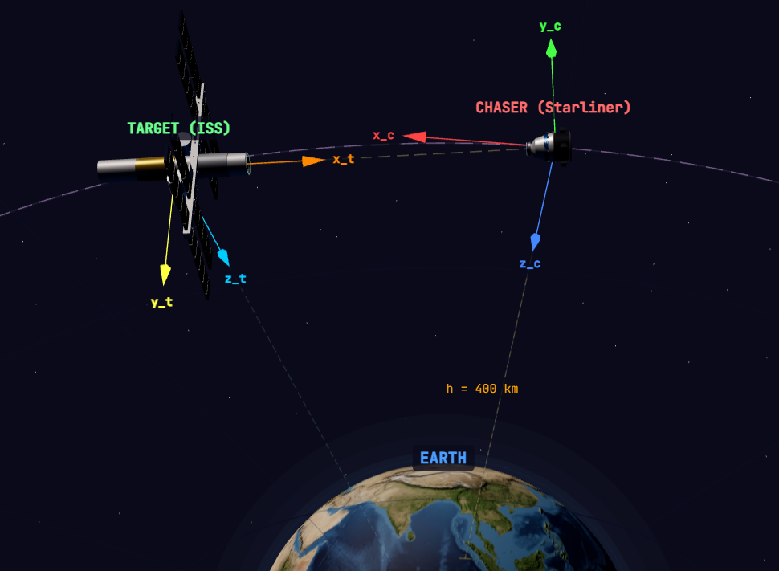
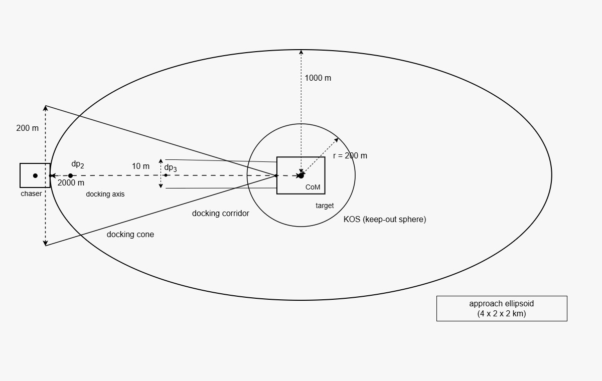

# Implemented Planar 3-DoF Scenario

## 1. Purpose and Scope

This document defines the rendezvous-and-docking scenario implemented by [`core.py`](../src/envs/docking3dof/core.py) and [`gym_env.py`](../src/envs/docking3dof/gym_env.py). The model represents target-relative translation in the V-bar-H-bar plane and rotation about the R-bar axis. It contains six state variables and three control inputs and is referred to as a planar 3-DoF model.

The modeled mission contains two sequential tasks:

1. Closing phase: P2 to a sampled P3 handover state.
2. Final-approach phase: P3 to an admissible docking state.


The closing phase reduces range and converges to an episode-specific position, velocity, attitude, and angular-rate target. The final-approach phase controls docking-port position, velocity, attitude, and angular rate inside the approach geometry.

The implementation does not include six-degree-of-freedom motion, absolute orbital propagation, vehicle mass or inertia, thruster allocation, environmental disturbances, or physical contact and capture dynamics.

## 2. Reference Frames and State

### 2.1 Target-Centered Orbital Frame

The target-centered orbital frame is

```
F_O = {V-bar, H-bar, R-bar}.
```

- `x_O` is the V-bar direction, aligned with the target velocity and the docking axis.
- `y_O` is the H-bar direction, normal to the orbital plane.
- `z_O` is the R-bar direction, directed toward Earth.

The target center of mass is the origin. The chaser starts on the positive `x_O` side and approaches toward decreasing `x_O`.


### 2.2 Chaser Body-Frame

The chaser body-frame is fixed to the chaser center of mass. At nominal face-to-face alignment, the chaser body `+x` axis points along `-x_O`, toward the target docking interface.



### 2.3 State

The simulator state is

```
x = [rx, ry, vx, vy, psi, omega_z].
```

- `[rx, ry]` is the chaser center-of-mass position relative to the target center of mass in the `x_O-y_O` plane.
- `[vx, vy]` is the corresponding relative velocity.
- `psi` is the chaser attitude error about `z_O`.
- `omega_z` is the relative angular velocity about `z_O`.

Angles are represented internally in radians. Wrapped attitude errors lie in `[-pi, pi)`.

The model omits R-bar translation, roll and pitch error, and angular-rate components about the omitted axes. These quantities are absent from the state rather than constrained to remain near zero.

## 3. Docking-Port Geometry and Kinematics

### 3.1 Face-to-Face Rotation

The planar rotation from the chaser body frame to the orbital frame is

```
R_Bc_to_O(psi) =
    [[-cos(psi),  sin(psi)],
     [-sin(psi), -cos(psi)]].
```

The negative signs encode the nominal face-to-face orientation. At `psi = 0`, positive chaser-body x acceleration maps to negative `x_O` acceleration.

### 3.2 Port Offsets

The default docking-port offsets are

```
r_c_body    = [4.1, 0.0] m
r_t_orbital = [20.0, 0.0] m.
```

The chaser value is the planar IDSS-15T reference offset. The target value is the planar projection of the IDSS-350T offset `[20, 0, 2] m`; the R-bar component is not represented. Both offsets can be replaced when constructing the core environment.

### 3.3 Port-Relative Quantities

The docking-port relative position is

```
r_p = [rx, ry] + R_Bc_to_O(psi) r_c_body - r_t_orbital.
```

With

```
S = [[0, -1],
     [1,  0]],
```

the port-relative velocity is

```
v_p = [vx, vy] + omega_z S R_Bc_to_O(psi) r_c_body.
```

The target port is stationary in the relative-frame model. The derived docking quantities are

```
s     = r_p,x
rho   = |r_p,y|
s_dot = v_p,x.
```

Port quantities are used by the docking cone, corridor, velocity monitor, observations, and terminal set. The approach ellipse and keep-out circle use center-of-mass position.

## 4. Dynamics and Numerical Propagation

### 4.1 Orbital Constants

The reduced orbital model uses

```
mu = 3.986004418e14 m^3/s^2
r0 = 6,778,000 m
n  = sqrt(mu / r0^3).
```

The value of `r0` corresponds to an Earth radius plus an approximately `400 km` circular-orbit altitude. Inclination, RAAN, argument of perigee, true anomaly, and absolute target and chaser states are not propagated.

### 4.2 Equations of Motion

Let `[a_x_O, a_y_O, alpha_z]` be the clipped body command after transformation into the orbital frame. The implemented equations are

```
r_chaser = sqrt(r0^2 + rx^2 + ry^2)

rx_dot = vx
ry_dot = vy

vx_dot = -mu rx / r_chaser^3 + n^2 rx + a_x_O
vy_dot = -mu ry / r_chaser^3          + a_y_O

psi_dot     = omega_z
omega_z_dot = alpha_z.
```

These equations form a reduced nonlinear relative model. Full LVLH Coriolis, centrifugal, radial, and three-axis rotational coupling are not implemented. Environmental forces and torques are not applied.

### 4.3 Integration and Episode Time

- Default integration step: `1 s`.
- Default integrator: fourth-order Runge-Kutta (`RK4`).
- Optional integrator: forward Euler.
- Default Gymnasium closing horizon: `12,000 s`.
- Default Gymnasium final-approach horizon: `5,000 s`.

The timestep and horizon are configurable. Direct construction of the lower-level core requires an explicit `max_time` value; the core does not assign a fallback horizon.

## 5. Control Input

### 5.1 Physical Action

The core action is a chaser body-frame acceleration command:

```
u_Bc = [a_x_Bc, a_y_Bc, alpha_z].
```

The default component-wise bounds are

```
-0.01  <= a_x_Bc  <= 0.01  m/s^2
-0.01  <= a_y_Bc  <= 0.01  m/s^2
-0.003 <= alpha_z <= 0.003 rad/s^2.
```

The translational bounds form a box in the chaser body frame. A simultaneous maximum command on both translational axes has magnitude `sqrt(2) * 0.01 m/s^2`. Translational commands are rotated into the orbital frame before propagation.

The action represents an ideal lower-level acceleration command. Thruster selection, force and torque conversion, minimum impulse, pulse-width modulation, propellant use, actuator delay, mass variation, and allocation are not modeled.

### 5.2 Gymnasium Action

The default Gymnasium action lies in `[-1, 1]^3` and is scaled by

```
[0.01, 0.01, 0.003].
```

The physical action interface can be selected by disabling action normalization.

The default control interval is one integration step. An optional fixed action hold repeats one action for a positive integer number of integration steps and sums the undiscounted substep rewards. Closing also supports an adaptive hold threshold that returns to single-step control near P3 or after entering a warning state.

## 6. Mission Phases and Initialization

All initialization positions are center-of-mass coordinates. Port position is derived from the sampled state and port offsets.

### 6.1 Closing Phase

The closing phase starts from P2. Each reset also samples a separate P3 target from the same operating mode.

Nominal P2 state:

```
[rx, ry, vx, vy, psi, omega_z]
= [1700, 0, -0.10, 0, 0, 0].
```

P2 testing range:

```
rx      in [1600, 1800] m
ry      in [-100, 100] m
vx      in [-0.15, -0.05] m/s
vy      in [-0.02, 0.02] m/s
psi     in [-3, 3] deg
omega_z in [-0.05, 0.05] deg/s.
```

P2 training range:

```
rx      in [1500, 1900] m
ry      in [-150, 150] m
vx      in [-0.20, -0.03] m/s
vy      in [-0.03, 0.03] m/s
psi     in [-5, 5] deg
omega_z in [-0.10, 0.10] deg/s.
```

At nominal alignment, `rx = 1700 m` produces the port-axial separation

```
s = 1700 - 4.1 - 20 = 1675.9 m.
```

### 6.2 Final-Approach Phase

The final-approach phase starts from P3.

Nominal P3 state:

```
[rx, ry, vx, vy, psi, omega_z]
= [300, 0, -0.03, 0, 0, 0].
```

P3 testing range:

```
rx      in [280, 320] m
ry      in [-3, 3] m
vx      in [-0.05, -0.01] m/s
vy      in [-0.01, 0.01] m/s
psi     in [-1, 1] deg
omega_z in [-0.05, 0.05] deg/s.
```

P3 training range:

```
rx      in [250, 350] m
ry      in [-5, 5] m
vx      in [-0.06, -0.01] m/s
vy      in [-0.02, 0.02] m/s
psi     in [-2, 2] deg
omega_z in [-0.10, 0.10] deg/s.
```

At nominal alignment, `rx = 300 m` produces `s = 275.9 m`.

The port-level corridor is evaluated after attitude and port-offset effects are applied. A sampled P3 state can therefore lie outside the `5 m` corridor while remaining inside the docking cone.

### 6.3 P3 Handover Target

Closing succeeds when every state component lies within the following tolerance of the sampled P3 target:

```
|rx - rx_target|           <= 20 m
|ry - ry_target|           <= 2 m
|vx - vx_target|           <= 0.01 m/s
|vy - vy_target|           <= 0.01 m/s
|wrap(psi - psi_target)|   <= 0.5 deg
|omega_z - omega_z,target| <= 0.05 deg/s.
```

The episode-specific phase distances are calculated from port geometry:

- Closing `d_P2` is the initial port-axial separation.
- Closing `d_P3` is the sampled target port-axial separation.
- Final-approach `d_P3` is the initial port-axial separation.

## 7. Safety Monitor



### 7.1 Primitive Geometry

The approach ellipse and keep-out circle are evaluated using center-of-mass position:

```
E_AE = {(rx, ry) : (rx/2000)^2 + (ry/1000)^2 <= 1}

S_KOS = {(rx, ry) : sqrt(rx^2 + ry^2) <= 200 m}.
```

The docking cone and final corridor are evaluated using port position:

```
C_cone = {x : 0 <= s <= 2000 m and rho <= 0.1 s}

C_corr = {x : 0 <= s <= d_P3 and rho <= 5 m}.
```

### 7.2 Alignment Classification

```
A_safe = {x : |psi| <= 3 deg and |omega_z| <= 0.15 deg/s}

A_warn =
    {x : |psi| <= 4 deg and |omega_z| <= 0.20 deg/s}
    \ A_safe

A_unsafe = {x : |psi| > 4 deg or |omega_z| > 0.20 deg/s}.
```

Alignment is calculated in both phases. It contributes to hard safety only during final approach. During closing it remains a diagnostic, reward, and handover quantity.

### 7.3 Velocity Classification

Closing:

```
V_safe_close = {x : ||v_p|| <= 0.25 m/s and |s_dot| <= 0.15 m/s}

V_warn_close =
    {x : ||v_p|| <= 0.35 m/s and |s_dot| <= 0.25 m/s}
    \ V_safe_close

V_unsafe_close = {x : ||v_p|| > 0.35 m/s or |s_dot| > 0.25 m/s}.
```

Final approach:

```
V_safe_final = {x : ||v_p|| <= 0.15 m/s and |s_dot| <= 0.10 m/s}

V_warn_final =
    {x : ||v_p|| <= 0.20 m/s and |s_dot| <= 0.15 m/s}
    \ V_safe_final

V_unsafe_final = {x : ||v_p|| > 0.20 m/s or |s_dot| > 0.15 m/s}.
```

### 7.4 Closing Classification

```
G_safe_close =
    (E_AE \ S_KOS) intersect C_cone intersect {d_P3 <= s <= d_P2}

G_unsafe_close =
    (S_KOS \ C_cone) union complement(E_AE)

G_warn_close =
      (E_AE \ (S_KOS union C_cone))
    union (S_KOS intersect C_cone)
    union (E_AE intersect C_cone intersect {s < d_P3}).
```

The combined classifications are

```
X_safe_close   = G_safe_close intersect V_safe_close
X_unsafe_close = G_unsafe_close union V_unsafe_close
X_warn_close   = (G_warn_close union V_warn_close) \ X_unsafe_close.
```

A state inside the ellipse, outside the keep-out circle, and inside the cone with `s > d_P2` is not assigned to the safe, warning, or unsafe geometry classes. The current environment does not terminate solely because of this condition.

### 7.5 Final-Approach Classification

```
G_safe_final   = C_cone intersect C_corr
G_unsafe_final = complement(C_cone)
G_warn_final   = C_cone \ C_corr

X_safe_final =
    G_safe_final intersect V_safe_final intersect A_safe

X_unsafe_final =
    G_unsafe_final union V_unsafe_final union A_unsafe

X_warn_final =
    (G_warn_final union V_warn_final union A_warn) \ X_unsafe_final.
```

Warning states are nonterminal. Unsafe states terminate the episode as failures.

## 8. Terminal and Episode Logic

### 8.1 Docking Set

The numerical docking set is

```
X_contact = {
    x : ||r_p|| <= 0.10 m,
        ||v_p|| <= 0.10 m/s,
        |psi| <= 4 deg,
        |omega_z| <= 0.20 deg/s
}.
```

The safety monitor is evaluated before success. Final-approach success therefore requires membership in `X_contact` without an unsafe final-approach classification.

This condition is a numerical guidance tolerance. Collision response, compliant contact, soft capture, latching, hard capture, rebound, and structural loads are not simulated.

### 8.2 Outcome Order

After each propagation step, outcomes are evaluated in the following order:

1. Hard safety failure.
2. Phase success.
3. Time limit.
4. Episode continuation.

Closing success is membership in the sampled P3 target tolerance. Final-approach success is membership in the effective docking set. A hard failure sets `terminated = true`; a time limit sets `truncated = true` without setting the physical-failure flag.

## 9. Reinforcement-Learning Interface

### 9.1 Observations

The final-approach observation contains six port-level values:

```
[r_p,x, r_p,y, v_p,x, v_p,y, psi, omega_z].
```

The closing observation contains the port state followed by the error relative to the sampled P3 state:

```
[r_p,x, r_p,y, v_p,x, v_p,y, psi, omega_z,
 rx-rx_target, ry-ry_target,
 vx-vx_target, vy-vy_target,
 wrap(psi-psi_target), omega_z-omega_z,target].
```

The observation spaces are unbounded Gymnasium `Box` spaces with shapes `(6,)` and `(12,)`, respectively.

### 9.2 Default Closing Reward

The default closing reward version is `v15`. Let `e = x - x_P3,target`, with the angular component wrapped, and define

```
d_pos   = ||e_position||
d_vel   = ||e_velocity||
e_y     = |e_lateral_position|
e_vy    = |e_lateral_velocity|
e_psi   = |e_attitude|
e_omega = |e_angular_rate|

delta_d     = previous(d_pos) - current(d_pos)
delta_e_psi = previous(e_psi) - current(e_psi)

D_s = clip((|s_dot| - 0.15) / (0.25 - 0.15), 0, 1)
D_v = clip((||v_p|| - 0.25) / (0.35 - 0.25), 0, 1).
```

The no-progress indicator is one when `d_pos > 50 m` and `delta_d < 0.01 m`; otherwise it is zero. With `u_norm` denoting the normalized physical action,

```
r_close,v15 =
    - 0.002 d_pos
    - 0.5   d_vel
    - 0.01  e_y
    - 5.0   e_vy
    - 5.0   e_psi
    + 50.0  delta_e_psi
    - 0.1   e_omega
    - 0.01  ||u_norm||
    + 20.0  delta_d
    - 20.0  D_s^2
    - 20.0  D_v^2
    - 0.05  I_no_progress.
```

### 9.3 Implemented Closing Reward Variants

The `closing_reward_version` parameter accepts the following implemented variants:

| Version | Implemented modification |
|---|---|
| `v15` | Default reward defined above. |
| `v15_dt` | Scales persistent reward terms by `dt / 1 s`; progress and event terms retain their original scale. |
| `v15_dt_safe` | Uses time-scaled persistent terms, bounded tolerance-normalized alignment costs, pre-warning velocity guards, and event values of `-50,000` for failure, `+50,000` for success, and `-10,000` for timeout. |
| `v16` | Adds clipped mean and maximum P3 tolerance-normalized error costs to `v15`. |
| `v17` | Replaces the `v16` terminal costs with progress through a logarithmic smooth-maximum terminal potential. |
| `v18` | Uses the `v17` potential with a larger terminal-progress scale. |
| `v19` | Applies the smooth tolerance-normalized terminal cost directly and removes the differently scaled `v15` state and progress terms. |
| `v20` | Retains the `v19` terminal-state objective and restores the two `v15` velocity warning-band penalties. |

The selected version and each additive component are recorded in the step diagnostics.

### 9.4 Final-Approach Reward

Define

```
rho_ratio   = rho / max(0.1 s, 1e-6)
psi_ratio   = |psi| / 3 deg
speed_ratio = ||v_p|| / 0.15

center_quality    = exp(-3 rho_ratio^2)
near_field_weight = exp(-s / 50)

delta_rp  = previous(||r_p||) - current(||r_p||)
delta_rho = previous(rho) - current(rho).
```

The implemented final-approach reward is

```
r_final =
    - 0.03 ||r_p||
    - 3.0  ||v_p||
    - 0.5  rho
    - 5.0  |psi|
    - 1.0  |omega_z|
    - 0.02 ||u_norm||^2
    - 2.0  u_norm,alpha^2
    + 45.0 delta_rp (0.25 + 0.75 center_quality)
    + 5.0  delta_rho
    - 10.0 max(0, rho_ratio - 0.4)^2
    - 25.0 near_field_weight rho_ratio^2
    - 25.0 max(0, psi_ratio - 0.5)^2
    - 20.0 max(0, speed_ratio - 0.7)^2.
```

### 9.5 Event Terms

Except for the event values specific to `v15_dt_safe`, the following terms are added after the phase reward:

```
r_event =
    - 10   I_warning
    - 1000 I_failure
    + 1000 I_success
    - 200  I_timeout.
```

## 10. Implemented Limitations

1. The planar state cannot represent R-bar translation, roll or pitch error, or coupling through the omitted axes.
2. The reduced orbital equations are not a complete three-dimensional LVLH propagator.
3. Direct acceleration commands assume ideal lower-level actuation.
4. Vehicle mass, inertia, thruster allocation, minimum impulse, propellant use, and actuator dynamics are absent.
5. The target is passive and fixed in the target-centered frame.
6. Environmental disturbances are absent.
7. The target IDSS-350T R-bar port offset is omitted by the planar projection.
8. Docking success is a numerical tolerance and not a physical contact or capture model.
9. Closing alignment is not a hard safety constraint.
10. Warning states are admissible and penalized rather than terminal.
11. Closing geometry contains an unclassified `s > d_P2` condition inside the otherwise admissible cone and ellipse region.
12. Results obtained in this environment apply to the implemented planar model and do not establish six-degree-of-freedom docking performance.

## 11. Implementation Authority and Sources

The numerical and logical definitions in this document correspond to:

- [`core.py`](../src/envs/docking3dof/core.py) for state propagation, port geometry, initialization, safety monitoring, and terminal logic;
- [`gym_env.py`](../src/envs/docking3dof/gym_env.py) for observations, action normalization, action holding, rewards, and Gymnasium termination semantics.

The default port offsets use reference geometry from the [International Docking System Standard, Interface Definition Document, Revision E, October 2016](https://www.internationaldockingstandard.com/download/IDSS_IDD_Revision_E.pdf), Section 3.3.1.2 and Table 3.3.1.2-1. The named IDSS vehicle cases provide reference offsets only; the implementation does not instantiate the associated full vehicle dynamics.
